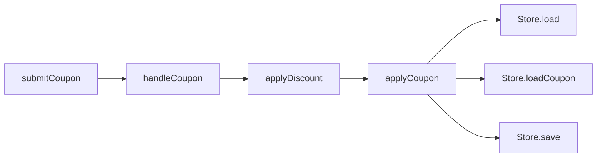

# Reading and writing Vitrifi

A `.vitrifi` file is a map of a feature: what it does, the values it accepts and returns, the state it touches, the behavior it promises, and the implementation behind it. The application still runs its Python, Ruby, JavaScript, TypeScript, or Java code. Vitrifi compiles the map and checks its relationships against each other and selected facts from that code.

Read this guide beside [the checkout feature](../examples/checkout/discounts.vitrifi). It explains the language from a reader's perspective, then shows how to write your own feature. Use the [syntax reference](language.md) for every field and its exact rules, and [compiler architecture](architecture.md) for implementation details. These docs describe the current prototype; [idea.md](../idea.md) is an exploration of broader possibilities.

## The vocabulary at a glance

| Construct | The question it answers | Example |
| --- | --- | --- |
| `feature` | Which product behavior or shared capability does this file describe? | Checkout discounts |
| `purpose` | Why does this feature or operation exist? | Let a customer apply a coupon safely |
| `question` | Which design decision is still open? | Can a customer replace an existing coupon? |
| `type` | What kind of value crosses an operation's interface? | A receipt, cart, or rejection |
| `resource` | Which state or capability can an operation affect? | Stored carts, a queue, or an external service |
| `requirement` | Which named behavioral rule do we need to preserve? | Rejection must leave stored carts unchanged |
| `operation` | Which meaningful action does the feature perform? | Apply a coupon |
| `bind` | Where is that action implemented? | A Python function in `domain/discounts.py` |
| `effects` | Which resource actions may this operation involve, including through calls? | Read carts and coupons; write carts |
| `requires` / `ensures` | What does the operation assume / promise? | An authenticated actor / no writes on rejection |
| `calls` | Which other operations does it depend on? | Load a cart, look up a coupon, save a cart |
| `boundary` / `allows` | Which implementation files belong together, and which other file groups may they import? | Workflow may import domain |
| `check` / `covers` | Which command provides evidence for which requirements? | Run the coupon tests |
| `use` / `export` | How does this feature refer to another feature's public declarations? | Import shared storage as `Store` |

## Read one small feature

This is a condensed version of the checkout file, focusing on one operation and two requirements. Its paths assume the location of the existing `examples/checkout/discounts.vitrifi`; the complete demo includes the browser and workflow as well.

```vitrifi
use "./storage/cart.vitrifi" as Store;

feature Checkout.Discounts {
  purpose "Apply a valid coupon without changing a rejected cart.";
  question "Should customers be able to replace an existing coupon?";

  export type Receipt;
  export type Rejected;

  export requirement AuthenticatedActor "The host supplies an authenticated actor id; a client-supplied id is insufficient.";
  export requirement RejectNoWrite "A rejected request performs no cart writes.";

  boundary Domain ["./domain/*.py"] allows [Store.Storage];

  export operation applyCoupon(actor: String, cart: String, code: String) -> Result<Receipt, Rejected> {
    purpose "Authorize and validate before persisting the discounted cart.";
    bind python "./domain/discounts.py" symbol "apply_coupon";
    effects [read Store.Carts, read Store.Coupons, write Store.Carts];
    requires [AuthenticatedActor];
    ensures [RejectNoWrite];
    calls [Store.load, Store.loadCoupon, Store.save];
  }

  check Behavior {
    run ["python3", "-m", "unittest", "discover", "-s", "tests", "-v"];
    cwd ".";
    covers [RejectNoWrite];
    timeout 30;
  }
}
```

There is no business logic inside this file. Its bodies contain declarations and relationships. The conditionals, calculations, and persistence calls live in the bound Python implementation.

### Start with the feature and its imports

`feature Checkout.Discounts { ... }` gives the module a name. One file contains one feature. The dotted name is a label; it does not create nested features or require a matching directory hierarchy.

`use "./storage/cart.vitrifi" as Store;` makes the other file's exported declarations available under the local alias `Store`. When you see `Store.save`, open that imported file and find `export operation save`. When you see `Store.Carts`, look for `export resource Carts` instead. The compiler checks that each reference names the right kind of declaration.

All declarations are private to their feature unless marked `export`. Exporting means other Vitrifi modules can refer to the declaration. It does not create an HTTP endpoint, export a host-language symbol, or expose code at runtime. In this example, other features can call `applyCoupon` in their architecture declarations; `Domain` remains an internal file grouping.

Imports, bindings, boundary paths, and check working directories are relative to the `.vitrifi` file that contains them. There is no central registry to update when adding a feature.

### Read intent, promises, and open decisions separately

These three forms do different jobs:

```vitrifi
purpose "Apply a valid coupon without changing a rejected cart.";
requirement RejectNoWrite "A rejected request performs no cart writes.";
question "Should customers be able to replace an existing coupon?";
```

`purpose` gives a short explanation of intent. Write it at feature level for the whole capability, or inside an operation to explain that action's responsibility. It is prose without a name, so other declarations cannot refer to it. It is optional.

`requirement` gives a rule a reusable name. Operations refer to that name through `requires` and `ensures`; checks refer to it through `covers`. Put concrete behavior here: who may act, what failure preserves, what must never happen, or what success guarantees. Prefer a rule such as “A rejected request performs no cart writes” over “Handle errors correctly.”

`question` records an unresolved decision at feature level. It is optional and may appear more than once. A question does not change the current policy or block compilation. In the full demo, the `SingleCoupon` requirement still forbids replacement while the question records whether that should change.

All three contain authored text. The compiler understands their structure and references, but does not interpret the sentences as executable rules. Use ordinary comments for local explanatory notes; use a requirement when operations or tests should point to a named promise.

### Understand types and resources

A **type** names a kind of value. In the example, `Receipt` and `Rejected` describe the two possible outcomes of applying a coupon:

```vitrifi
export type Receipt;
export type Rejected;
```

These are opaque, named types: Vitrifi knows that the names identify different kinds of values, but has no field definitions for either. You do not put `cartId`, `total`, or constructors inside a Vitrifi type in this prototype. Those details stay in the host code. A type declaration also does not automatically bind to a Python class or Java type with a similar name.

Built-in types include `String`, `Int`, `Bool`, `Unit` (no meaningful return value), and `Any` (an unspecified value type). `List<Receipt>` describes a list of receipts, `Option<Receipt>` an optional receipt, and `Result<Receipt, Rejected>` success or rejection. Nesting is allowed, for example `List<Option<String>>`. The compiler checks the names and the number of type arguments.

A **resource** names state or a capability whose use matters to the architecture. The imported storage feature declares:

```vitrifi
export type Cart;
export resource Carts;
```

| Name | Read it as | Where it is used |
| --- | --- | --- |
| `Cart` | One cart value passed into or returned from an operation | `save(cart: Cart) -> Unit` |
| `Carts` | The stored cart state that operations can read or change | `effects [write Carts];` |

The singular/plural naming helps humans; the keywords make the distinction real. There is no automatic link between the two names. A resource has no fields or body, and does not create a database or constrain the stored data's type.

Choose resources at a useful review level: `Carts`, `FormState`, `AuditEvents`, or `PaymentGateway`. Avoid making every local variable a resource. Define a shared resource once in the feature that owns the capability and import it elsewhere, so every operation refers to the same identity.

### Read an operation as a contract

Take the signature first:

```vitrifi
export operation applyCoupon(actor: String, cart: String, code: String) -> Result<Receipt, Rejected> {
```

Read it as: “Other features may refer to an action named `applyCoupon`. It accepts three string values and has an architectural outcome of a receipt or a rejection.” The `cart` argument is a string identifier here, not a `Store.Cart` value.

The body then answers separate questions:

| Field | How to read it in this example |
| --- | --- |
| `purpose` | The action authorizes and validates before persistence. |
| `bind` | Its implementation is the `apply_coupon` definition in this Python file. |
| `effects` | Its declared footprint includes reading carts, reading coupons, and writing carts. |
| `requires` | It assumes the supplied actor has already been authenticated. |
| `ensures` | It promises that rejected requests cause no cart writes. |
| `calls` | It depends on the storage operations `load`, `loadCoupon`, and `save`. |

An operation needs typed parameters, a result type, and one `bind`. The other fields are optional. Parameters may be empty, as in `entries()`. Omitting a relationship list means an empty declared list; it does not ask Vitrifi to discover it from the implementation.

`bind` gives you the next place to look when the contract is insufficient. Vitrifi checks that the selected host definition exists. The architecture name and implementation name can differ: `applyCoupon` binds to `apply_coupon`. The prototype does not compare the complete host signature to the Vitrifi signature. In this demo, the Python function returns a receipt or raises an exception; `Result<Receipt, Rejected>` describes that outcome abstractly, without adding a runtime wrapper.

Types and resources mentioned in an exported operation's contract must also be exported, as must its `requires` and `ensures` requirements. This lets another feature understand the whole public contract. An exported operation may still declare calls to private helper operations.

### Follow calls and carry the effects with you

`calls [Store.load, Store.loadCoupon, Store.save];` is a list of declared dependencies. It does not say that all three run on every path, that they run in that order, or which arguments they receive. In particular, rejected requests must skip the save. The implementation determines control flow.

Each call also creates an effect obligation. In the storage feature:

```vitrifi
export operation save(cart: Cart) -> Unit {
  bind python "./repository.py" symbol "save_cart";
  effects [write Carts];
}
```

Because `applyCoupon` declares a call to `Store.save`, it must include `write Store.Carts` in its own effects. The same rule applies to callers of `applyCoupon`. That is why the full demo's transport operation lists storage effects even though it delegates the storage work.

Effects describe the operation's declared footprint across its possible paths. Listing `write Store.Carts` and promising no writes **on rejection** are compatible: a successful request may write. The language currently has no syntax for conditional effects.

The supported actions are `read`, `write`, `network`, and `emit`. They all target resources. Treat them as explicit actions: `write Carts` does not include `read Carts` automatically. `network PaymentGateway` or `emit AuditEvents` can describe other kinds of resource use; the compiler checks reference and call consistency, not whether the host performs those actions correctly.

`requires` and `ensures` are different from effect checking. The compiler checks that they name requirements, but does not prove that a caller satisfies its callee's preconditions or that a callee's promises imply the caller's promises. Authentication remains a host responsibility in this example.

### Read boundaries as rules about implementation imports

The full discount feature contains these two declarations:

```vitrifi
boundary Domain ["./domain/*.py"] allows [Store.Storage];
boundary Workflow ["./workflow/*.py"] allows [Domain];
```

A **boundary** gives a name to a group of host files. `allows` lists other boundaries those files may directly import. The workflow may import domain files; domain files may import storage files. The workflow has no direct permission to import storage. Permissions are directional and do not become transitive. Imports within the same boundary are allowed.

Compare the three different relationships:

| Declaration | Meaning |
| --- | --- |
| `calls [applyCoupon];` | This operation declares a dependency on another operation. |
| `effects [write Store.Carts];` | This operation exposes an effect on stored cart state. |
| `boundary Workflow [...] allows [Domain];` | These host files may directly import domain files. |

An operation can expose storage effects through delegation without its implementation being allowed to import storage directly. The compiler does not turn a `calls` relationship into an import permission.

Boundaries apply to resolved local host imports, including unused imports. They do not enforce every possible runtime access or network interaction. External or unresolved imports remain analysis gaps. Files are grouped by path, not by where an operation appears in the `.vitrifi` file. Overlapping groups are an error for analyzed files. See the [boundary reference](language.md#boundary-and-allows-permitted-implementation-imports) for matching details, including the prototype's `*` matching across subdirectories.

### Look for evidence after reading a promise

The `Behavior` check runs a command and connects it to `RejectNoWrite` through `covers`. Read it as: “This command is intended to test this requirement.” `run` is an array of command arguments, `cwd` chooses its working directory relative to the feature file, and `timeout` is a limit in seconds.

`vitrifi check` compiles the feature but does not run that command. `vitrifi verify` compiles and then runs the declared checks. A passing run is evidence for the tested scenarios; `covers` is an authored claim about what the tests exercise. Read the tests when assessing the strength of that evidence.

The condensed example covers `RejectNoWrite`, but not `AuthenticatedActor`. That distinction matters: passing this check does not establish that authentication is implemented. The full demo attaches its Python checks to four requirements; its UI and audit promises have no attached behavioral checks.

## Follow the complete checkout feature

The complete [discounts.vitrifi](../examples/checkout/discounts.vitrifi) describes the browser, transport, workflow, and domain in one file. Each arrow below means “appears in the caller's `calls` list.” It shows declared dependencies, not an execution sequence or deployed service wiring.



Follow `submitCoupon → handleCoupon → applyDiscount → applyCoupon`, then the three storage dependencies. `Store` is the only imported alias in this feature, so those last references take you to [storage/cart.vitrifi](../examples/checkout/storage/cart.vitrifi). The optional [audit feature](../examples/checkout/audit/discount.vitrifi) is separate; there is no declared call from the discount feature to it.

You do not have to read every operation in source order. For a pull request:

1. Read the feature's `purpose` and `question` entries to get the intent and open decisions.
2. Find the changed requirement or operation. Read its signature, promises, and effects.
3. Follow its `calls` references. For an imported name, follow `use` to the exported declaration. Also check callers when a callee's effects or contract change.
4. Follow `bind` into the implementation where you need to verify behavior.
5. Read the relevant boundaries if the implementation adds imports or moves files.
6. Find checks whose `covers` lists mention the affected requirements, then inspect the tests and their results.

For example, “allow replacing an applied coupon” first leads to the `SingleCoupon` requirement. It currently forbids replacement. Its change needs to agree with `applyCoupon`, the bound domain implementation, and the checks covering that requirement. A change to prose is a visible policy change, not evidence that the implementation follows it.

These commands support that reading process. Run them from the repository root with a Rust toolchain installed:

```sh
# Validate the discount feature and its imported storage feature.
cargo run -- check examples/checkout/discounts.vitrifi

# Print their contracts in the terminal.
cargo run -- inspect examples/checkout/discounts.vitrifi

# Read just the host definition bound to applyCoupon.
cargo run -- source examples/checkout/discounts.vitrifi applyCoupon

# Explicitly execute the checks in this feature and its imports.
cargo run -- verify examples/checkout/discounts.vitrifi
```

`cargo run --` invokes the CLI during development. If you built the release binary, you can use `./target/release/vitrifi` in its place. See the [checkout editing exercises](../examples/checkout/README.md) for examples of compiler feedback.

## Decide what belongs in a feature file

Choose a feature around a coherent behavior someone changes or reviews together: applying coupons, registering accounts, or delivering audit events. Keep its meaningful operations together even when they span several implementation layers or languages. Use boundaries inside the feature for technical layers. Extract a separate feature when a capability has its own ownership and reusable interface, as shared storage does in this demo.

The following is a useful authoring order, not a required declaration order:

1. Write a feature purpose and record unresolved decisions as questions.
2. Name the behavioral requirements reviewers need to preserve.
3. Define the value types that make operation interfaces understandable. Keep field layouts in the host language for now.
4. Define the resources this feature owns. Import shared resources instead of declaring another copy with the same meaning.
5. Add operations for the important actions and integration points, with bindings to real host definitions. Include private helpers when their relationships matter; you need not mirror every function.
6. Declare their resource effects, dependencies, assumptions, and promises. An empty list describes an empty declared relationship, not a completed analysis of the host code.
7. Add file boundaries where dependency restrictions matter, and checks that exercise named requirements.
8. Export the declarations other features need, including the types, resources, and requirements used in public operation contracts.

A minimal feature can be just `feature Example {}`. Add structure as it becomes useful, but be aware that omitted declarations give the compiler fewer things to check. To start a new file in an existing directory, `cargo run -- init path/to/feature.vitrifi` creates a small template.

Give each bound host symbol one owning operation across the compiled modules. If two features use the same operation, export it from its owner and import it from the other feature. Duplicate bindings are rejected. Private means private to a Vitrifi module; it does not hide the host implementation.

## What a successful check tells you

| A successful compilation checks… | You still need implementation review or other evidence for… |
| --- | --- |
| Syntax, names, imports, declaration kinds, and visibility | Whether the feature description includes everything important |
| Type names and generic arity | Host signature equivalence and the shape of values at runtime |
| The presence of a uniquely selected bound definition | Correctness of that definition |
| Effect inclusion along declared calls | Completeness of the declared calls and effects |
| Allowed resolved host imports between declared boundaries | Dynamic access, unresolved imports, and deployed service wiring |
| The structure of check declarations and their requirement references | The truth of behavioral prose and the adequacy of tests |

The file gives you a way to move from intent to contracts to implementation and evidence. Keep those links current alongside the source changes, and reviewers can follow the feature without having to reconstruct it from unrelated files.
